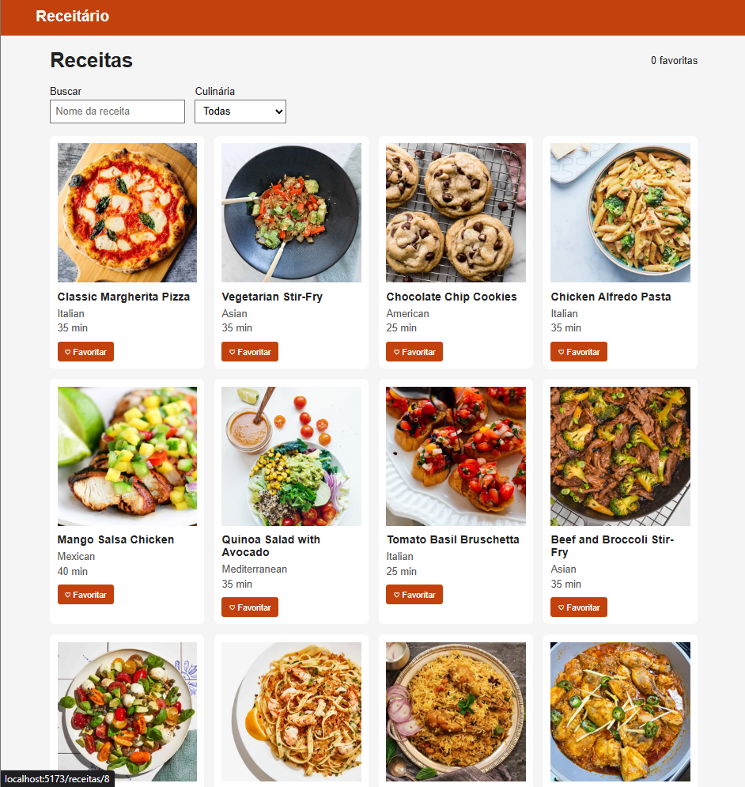

-Receitário

Catálogo de receitas feito com React + Vite + TypeScript usando a API da DummyJSON.

-Integrante

- Matheus Costa Rodrigues dos Santos - RM573146

-Deploy

https://receitario-cp5.vercel.app

-Print do catálogo

-Como rodar

npm install
npm run dev